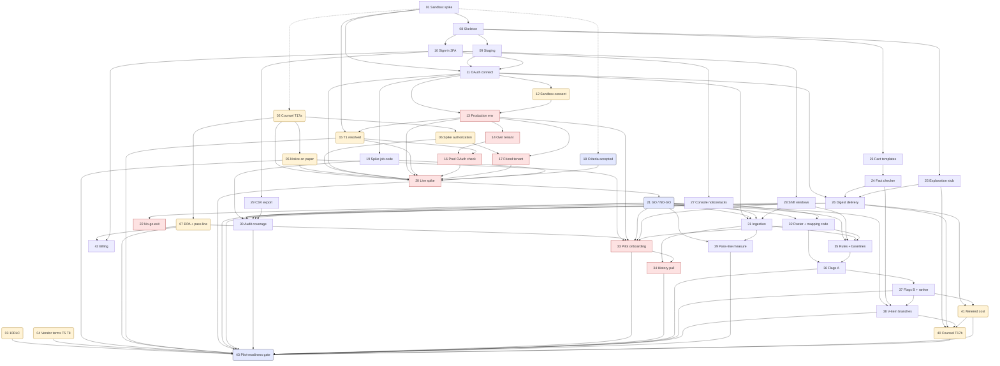

# TillOwl v1 build plan

Source of truth: `docs/architecture-pack-part1.md`, `docs/architecture-pack-part2.md` (Slides 1–30), `docs/R2-narrow-agent-plan.pdf`, `docs/R1-deep-research-report.pdf` (opened only through a subagent, in page ranges). Precedence: pack > R2 > R1; the checked facts of Oct 19, 2026 override R2 (Slide 27, O1 and O2). The planning prompt is saved verbatim at `docs/build/PLANNING_PROMPT.md`. Governance is in `docs/build/GOVERNANCE.md`. Written in Phase B1 on Oct 20, 2026.

## 1. Interview answers and approved outline

The founder approved the outline on Oct 20, 2026 ("Approve all"). "Founder asked me to pick" marks answers the founder delegated; each pick is also listed in §11 for acceptance.

| Topic | Answer | How it was set |
|---|---|---|
| Managed PostgreSQL (T9) | **Render Postgres**, one instance for staging and one for production (design choice). Paid plan needed. Render's docs (unverified candidate until STEP-09 and STEP-13 confirm it) say point-in-time recovery is "Past 3 days" on Hobby, "Past 7 days" on Pro or higher, none on Free; a restore creates a new instance ([Render backups](https://render.com/docs/postgresql-backups)). External connections are TLS with a per-database IP allowlist, default `0.0.0.0/0` ([Render connecting](https://render.com/docs/postgresql-creating-connecting)). Price: TBD — not in sources (D13). | Founder asked me to pick |
| Backup and PITR retention cap in the owner's spike authorization (T15-related) | **14 days.** Render's docs give Pro PITR as 7 days and logical exports as kept 7 days (unverified candidate until STEP-13), both inside the cap. | Founder |
| Email vendor (T5) | **Resend** (unverified candidate; its data terms are recorded in STEP-04) | Founder |
| Accounts we already have | **Render only.** No Square developer account, no Square production seller account of our own. | Founder |
| Long-lead registrations | **Twilio 10DLC starts now (STEP-03). Square app approval (T1) starts after the sandbox spike (STEP-15).** | Founder |
| How staff sign (T16) | **Paper.** Staff sign on paper; the restaurant keeps the originals. After go/no-go, with the owner's written support-access permission, the founder enters each acknowledgment and maps it to a Square login (STEP-27 builds it, STEP-33 runs it). The notice step needs no software. | Founder asked me to pick |
| Shift windows (T14, TD1) | **The owner sets them in the console at onboarding (STEP-28, run in STEP-33)**, audit-logged. If the owner can't, the founder enters them under support access. | Founder asked me to pick |
| Pilot start date | **Target about 6–8 weeks out (early December 2026).** Day one still waits for STEP-43. | Founder |
| GitHub plan | **Make the repo private; paid plan required.** Approved outline said Team. The docs show Pro on a personal account also gives private repos protected branches, CODEOWNERS enforcement, environments, environment secrets and deployment-branch rules ([protected branches](https://docs.github.com/en/repositories/configuring-branches-and-merges-in-your-repository/managing-protected-branches/about-protected-branches), [environments](https://docs.github.com/en/actions/how-tos/deploy/configure-and-manage-deployments/manage-environments)); Team needs the repo moved into an organization. Final choice: D3. | Founder asked me to pick |
| Founder's GitHub username | **Rmasood1122** (repo owner) | Founder (approval of outline) |
| Second code owner | **Ahmad317-Engineer** | Founder, Oct 20 |
| Operating systems | **Not answered** → D2 (blocks the G7 smoke tests, so STEP-01) | Open |
| `PRIVATE_EVIDENCE_DIR` | **`$HOME/TillOwl-private-evidence`, written out as an absolute path** on the founder's machine (for example `/Users/rehan/TillOwl-private-evidence`), on an encrypted disk, outside every git checkout. The exact absolute path is confirmed at install (D4). | Founder asked me to pick |
| Commit route for Phase B | Branch and PR from Rmasood1122; Ahmad317-Engineer reviews and approves. | Founder, Oct 20 |

**Changes from the approved outline** (made while writing this plan; each is small and listed so nothing changes silently):

1. Outline STEP-31 ("ingestion") and STEP-32 ("roster read, entry and mapping on production") became three steps, because one step has one gate kind: STEP-31 ingestion code (ci_fixture), STEP-32 roster-read job and mapping code (ci_fixture), STEP-33 pilot onboarding on production (production_job). Later ids moved up by one; the pilot-readiness gate is now STEP-43.
2. The owner's shift-window entry on production folds into STEP-33 (onboarding), since the console slice is first deployed to production after go/no-go.
3. STEP-06 now also collects the owner's written support-access permission (needed for paper T16 entry), so counsel reviews it under T17a.
4. STEP-41 (cost) became gate kind `human`: a metered estimate needs real model calls on synthetic flags, which CI may not make.
5. New founder decisions: D15 (legal entity), D16 (RK1 thresholds), D17 (gh on macOS), D18 (staging database exposure).
6. After an independent review: STEP-35 also depends on STEP-32 (the mapping); STEP-20 lists STEP-11 directly; STEP-40 depends on STEP-41, which saves the real-model sample outputs counsel reviews; STEP-24 and STEP-31 became ci_staging, so scenarios 1 and 2 run on staging; STEP-22's gate adds the notice-export receipt; steps 31–43 carry `runs_if: "GO"`.

## 2. Strategy

We build the cheapest proof that the data and the law allow a useful digest before we build anything that depends on either. A sandbox spike on our own Square test account (STEP-01) records the scopes, the production-approval rule and the API shape of V1–V8; a walking skeleton then goes to staging (STEP-08, 09) with OAuth and two-factor owner sign-in (STEP-10–12), and a production environment with our own-account OAuth check follows (STEP-13–16). In parallel from day one the human track runs counsel review T17a, 10DLC, vendor terms, the paper §52-c*2 notice, the owner's spike authorization and the Design Partner Agreement (STEP-02–07). Only when those are on file does a read-only, count-only spike run as a one-off production job on the friend's account (STEP-20), and the founder records GO or NO-GO against criteria committed beforehand (STEP-18, 21). Field-independent slices (fact templates, the number/time/name check, the explanation service with a stubbed model, the console, CSV export, audit coverage) run on synthetic fixtures from the skeleton onward; every step that reads Square fields waits for the decision and builds both the RETURNED and the NOT RETURNED branch. The pilot-readiness gate (STEP-43) turns on the nightly, explanation and digest jobs only after scenarios 1–4 pass, counsel signs off the templates (T17b), the cost is metered within the lean line, and every before-day-one item on Slides 26 and 30 is closed.

## 3. Step table

Gate commands use `pytest -c pytest.ini --rootdir=. tests/gates/step_NN` (shortened below to `pytest step_NN`); `check_artifact --label X --role Y` is short for `python tools/check_artifact.py --step STEP-NN --label X --role Y`, written in exactly that form with no other flags (the founder's run adds `--date` and staff counts, which `check_evidence.py` accepts). The status files carry the full commands. `done_requires` lists steps that must be done before the step's done PR merges but not before work starts. Sizes: S < half a day, M ≈ one day, W waits on someone outside the team. Assignee is blank for every step until the founder fills it in.

| ID | Title | Track | Lane | Gate kind | Outcome | Gate | Depends on | Done requires | Size |
|---|---|---|---|---|---|---|---|---|---|
| 01 | Square-sandbox spike | build | connector | sandbox_spike | `docs/build/findings/square-sandbox.md`: read-only scope names, Square's production-approval rule (doc URLs), whether the sandbox has an OAuth authorize flow, the API shape for each of V1–V8 (CAN_RETURN / CANNOT_RETURN / NOT_OBSERVABLE_IN_SANDBOX). Personal token on our own sandbox seller only. | `python spikes/square_sandbox.py --probe && python spikes/square_sandbox.py --check` | — | — | M |
| 02 | Counsel review T17a | human | legal | human | Counsel's signed review of: notice text, owner's spike authorization (incl. roster-read scope and support-access permission), DPA, and whether pre-notice history may feed per-login baselines | `python tools/check_artifact.py --step STEP-02 --label counsel_t17a --role counsel` | — | 01 | W |
| 03 | Twilio 10DLC and the owner's SMS opt-in (T6) | human | vendor | human | 10DLC approved; approval time, message limits and Twilio data terms on file; owner's opt-in on file | `check_artifact --label sms_optin --role owner && --label tendlc_approval --role vendor && --label terms_t6 --role vendor` | — | — | W |
| 04 | Vendor data terms: model vendor no-training (T8), email (T5) | human | vendor | human | Terms on file, or the founder's written template-only decision for T8 (D11) | `check_artifact --label terms_t5 --role vendor && --label terms_t8 --role vendor`; if D11 is chosen, a founder-approved gate-change PR swaps the second command to `--label t8_template_only --role founder` | — | — | S/W |
| 05 | §52-c*2 notice given, acknowledged on paper, posted | human | legal | human | Notice version, acknowledgment batch (count only, plus absent and refused counts), dated posting photo; owner told staff nobody is punished just for data showing up | `check_artifact --label notice --role owner && --label ack_batch --role staff && --label posting --role owner` | 02 | — | W |
| 06 | Owner signs the spike authorization and support-access permission | human | legal | human | Authorization names scopes, HMAC hashing, deletion check and the 14-day backup cap; written support-access permission for paper acknowledgment entry | `check_artifact --label authorization --role owner && --label support_permission --role owner` | 02 | — | W |
| 07 | Design Partner Agreement and pass line signed | human | legal | human | DPA with no-training and 30-day CSV export promises; pass line with both V1 variants and the T11 0.5–1 point rule; up-front 10–20% invoice issued | `check_artifact --label dpa --role owner && --label pass_line --role owner && --label upfront_invoice --role founder` | 02 | — | W |
| 08 | Repo skeleton | build | platform | ci_fixture | `tillowl` package, full v1 schema with RLS, insert-only audit role and `audit()`, business-day helper, migration runner, tests for the governance tools. The session also runs the gate locally inside its sandbox (G7) and pastes that output into the PR description | `pytest step_08` | 01 | — | M |
| 09 | Staging deploy, fake-data cron, alerts | build | platform | ci_staging | Console health check on staging, one cron run on fake data, per-run schema, cron-failure email alerts (stubbed in CI), missed-run watchdog | `pytest step_09` | 08 | — | M |
| 10 | Owner sign-in with TOTP two-factor | build | console | ci_fixture | Owner-only sign-in; failed and denied attempts audit-logged; no staff accounts exist | `pytest step_10` | 08 | — | M |
| 11 | Square OAuth connect | build | connector | ci_staging | Authorize, exchange, refresh ≤ 7 days, AES-256-GCM token storage, callback in the console, refresh-failure flag for scenario 4; Square mocked in CI | `pytest step_11` | 01, 09, 10 | — | M |
| 12 | First sandbox consent on staging | human | connector | human | Founder clicks consent on our sandbox seller; one connection stored; forced refresh works | `python -m tillowl.jobs.oauth_status --env staging --expect-connections 1 && python -m tillowl.jobs.refresh_tokens --env staging --force` | 11 | — | S |
| 13 | Production environment | build | platform | production_job | Production web service and DB with own secrets, RLS, AES key; PITR within the 14-day cap; restore test; OAuth redirect URL live; manual deploys only; only the token-refresh job scheduled | `python -m tillowl.jobs.health_check --env production && python -m tillowl.jobs.restore_check --env production && python -m tillowl.jobs.redirect_check --env production` | 11, 12 | — | M |
| 14 | Provision our own production tenant | build | platform | production_job | One tenant for our own Square seller, audit-logged | `python -m tillowl.jobs.provision_tenant --kind own` | 13 | — | S |
| 15 | T1 resolved | human | vendor | human | Square approval granted, or confirmed not required (default branch, D5) | `check_artifact --step STEP-15 --label t1_approval --role vendor` | 01, 13 | — | W |
| 16 | Production OAuth check on our own Square account | build | connector | production_job | Connect, refresh and revoke work on production Square with our own seller | `python -m tillowl.jobs.oauth_check --tenant own` | 14, 15 | — | S |
| 17 | Provision the friend's tenant and owner two-factor | build | platform | production_job | Pilot tenant; owner invited and enrolled in TOTP | `python -m tillowl.jobs.provision_tenant --kind pilot && python -m tillowl.jobs.onboarding_report --tenant pilot --expect-2fa` | 06, 13 | — | S |
| 18 | Go/no-go criteria accepted | human | gate | human | Founder edits and commits `go-no-go-criteria.md` without the DRAFT marker, through a gate-change PR | `python tools/check_evidence.py criteria` | — | 01 | S |
| 19 | Live-spike job code | build | connector | ci_fixture | `square_live_report` (field names, types and counts only; HMAC in memory) and `verify_deleted`; each V-result audit-logged | `pytest step_19` | 11 | — | M |
| 20 | Run the read-only live spike | build | connector | production_job | V1–V8 each RETURNED / NOT_RETURNED / PARTIAL in `findings/square-fields.md`; spike data deleted; last-backup expiry recorded; OAuth kept or revoked (D7) | `python -m tillowl.jobs.square_live_report --tenant pilot --check && python -m tillowl.jobs.verify_deleted --tenant pilot --scope spike` | 02, 05, 06, 11, 13, 15, 16, 17, 18, 19 | — | S |
| 21 | Go/no-go decision recorded | human | gate | human | GO or NO-GO judged under RK1 against the accepted criteria; `decision` set in its status file | `python tools/check_evidence.py decision` | 20 | — | S |
| 22 | No-go exit (runs only on NO-GO) | build | platform | production_job | Revoke OAuth, export notice and acknowledgment records to the owner, delete tenant data except spike/deletion audit rows, verify, record `backup_expires` for the last backup holding the data, settle the fee | `python -m tillowl.jobs.exit_tenant --tenant pilot && python -m tillowl.jobs.verify_deleted --tenant pilot --scope tenant && python tools/check_artifact.py --step STEP-22 --label notice_export --role owner && python tools/check_artifact.py --step STEP-22 --label invoice_settlement --role founder` | 21 | — | M |
| 23 | Fact templates and template manifest | build | digest | ci_fixture | Fixed fact lines incl. both fallback sentences; `MANIFEST.json` | `pytest step_23` | 08 | — | S |
| 24 | Digest fact checker and deny-list | build | digest | ci_staging | Every number, time and name must be in the stored flag; deny-list; failing sentences replaced by the template line (scenario 2) | `pytest step_24` | 23 | — | M |
| 25 | Explanation service, model stubbed | build | explain | ci_fixture | Pinned `claude-haiku-5-5`, low effort, login codes only, prompt < 100k tokens, all output tokens metered; production calls behind the T8 flag | `pytest step_25` | 08 | — | M |
| 26 | Digest build and delivery | build | digest | ci_staging | Owner only; email first; SMS behind a flag until STEP-03; digest log; reconnect message (scenario 4); vendors stubbed in CI | `pytest step_26` | 11, 24, 25 | — | M |
| 27 | Console: notice records, acknowledgment entry, support access | build | console | ci_fixture | Notice versions; acknowledgment entry and mapping screen; time-boxed owner grant for support access; every action audit-logged | `pytest step_27` | 10 | — | M |
| 28 | Console: shift windows and digest settings | build | console | ci_fixture | Windows in the restaurant's time zone, crossing midnight allowed; settings audit-logged | `pytest step_28` | 10 | — | S |
| 29 | CSV export and termination path | build | console | ci_fixture | 30-day CSV export of all flagged events; deletion per contract; audit-logged | `pytest step_29` | 10 | — | M |
| 30 | Audit-log coverage and scenario 3 | build | platform | ci_staging | Every listed event type writes an audit row; cross-tenant reads return zero rows | `pytest step_30` | 19, 26, 27, 28, 29 | — | S |
| 31 | Square event ingestion | build | connector | ci_staging | Nightly and date-range pull, events tagged with business day, shift window and (acknowledged) login; missed day re-pulled (scenario 1); a branch per V-item | `pytest step_31` | 11, 21, 27, 28 | — | M |
| 32 | Roster-read job and acknowledgment mapping | build | console | ci_fixture | Reads Square team-member ids and display names for the mapping only; display names never leave the console | `pytest step_32` | 21, 27 | — | M |
| 33 | Pilot onboarding on production | build | platform | production_job | Release deployed; roster read; owner sets shift windows; founder enters paper acknowledgments and maps them under the support-access grant | `python -m tillowl.jobs.roster_read --tenant pilot && python -m tillowl.jobs.onboarding_report --tenant pilot` | 05, 07, 13, 21, 28, 32 | — | S |
| 34 | 30-day history pull (V8) | build | connector | production_job | 30 days of events; logins stripped for unacknowledged logins and, per T17a, for pre-notice dates | `python -m tillowl.jobs.history_pull --tenant pilot --days 30 && python -m tillowl.jobs.onboarding_report --tenant pilot --history` | 31, 33 | — | S |
| 35 | Ratio rules and baselines | build | rules | ci_fixture | Counts and ratios per login and shift window; baselines for acknowledged logins only | `pytest step_35` | 21, 28, 31, 32 | — | M |
| 36 | Flags A: cancelled orders, item voids, approval codes, no-sale opens (V1–V4, V6) | build | rules | ci_fixture | Acknowledgment gate on every flag; RETURNED and NOT_RETURNED branches | `pytest step_36` | 32, 35 | — | M |
| 37 | Flags B: comps, discounts, refunds (V5, V7) and the ranker | build | rules | ci_fixture | Ranked flags with time-stamped evidence | `pytest step_37` | 36 | — | M |
| 38 | V-item branches in templates and checker | build | digest | ci_fixture | Unconfirmed fields left out or the fallback wording used | `pytest step_38` | 21, 24, 37 | — | S |
| 39 | Pass-line measurement | build | rules | ci_fixture | Voids + comps + discounts as % of net sales (or the DPA substitute), 30 days before and 60 after; the D10 opening measure | `pytest step_39` | 21, 31 | — | S |
| 40 | Counsel review T17b | human | legal | human | Counsel signs off templates, explanation prompt, deny-list and the real-model sample outputs STEP-41 saved; manifest hash recorded | `check_artifact --step STEP-40 --label counsel_t17b --role counsel && python tools/check_evidence.py manifest` | 25, 26, 38, 41 | — | W |
| 41 | Metered cost estimate (T9, scenario 5) | build | platform | human | Real model calls on synthetic flags measure tokens in, out and thinking, and save the outputs as the T17b samples (`docs/build/findings/llm-samples.md`, synthetic data only); SMS segments; Render web, cron and both databases at current prices; total ≤ the lean line. Runs in the founder's terminal with a non-production Anthropic key | `python -m tillowl.jobs.cost_estimate --sample tests/fixtures/cost_sample.json --live --check` | 26, 37 | — | S |
| 42 | Billing with one-click cancel | build | console | ci_fixture | Needed by day 90, not by STEP-43; provider is D12 | `pytest step_42` | 07, 10 | — | M |
| 43 | Pilot-readiness gate | human | gate | human | All pilot-gate conditions hold (§5); real SMS incl. the reconnect text to the founder's phone; then the founder enables the nightly, explanation and digest jobs | `python tools/check_evidence.py pilot-gate && python -m tillowl.jobs.health_check --env production && python -m tillowl.jobs.send_test --env staging --channel sms --to founder` | 03, 04, 05, 07, 15, 20, 21, 26, 30, 33, 34, 36, 37, 38, 39, 40, 41 | — | S |

**Critical path:** 01 → 08 → 09 → 11 → 12 → 13 → 15 (T1 wait) → 16 → 20 → 21 → 31 → 35 → 36 → 37 → 41 → 40 (counsel wait) → 43; STEP-38 (after 37) also feeds 40. The counsel branch 02 → 05/06 → 20 joins at the spike and is likely the longer wait. External waits on this path: T1 approval, counsel T17a and T17b, and 10DLC (STEP-03 feeds 43). The 6–8 week target holds only if counsel and Square approval each answer within about two weeks; nothing in the sources says they will.

**T1 dependency (D5).** Default branch, written into the status files: STEP-15 depends on 01 and 13, and STEP-16 depends on 15. If STEP-01 finds that Square approval requires a working production connect, the founder approves a gate-change PR that switches to: STEP-16 depends on 14 only, and STEP-15 depends on 16.

## 4. Dependency graph

Solid arrows are `depends_on`; dotted arrows are `done_requires`. Human steps are rounded.

## 5. Milestones and gates

| Milestone | Steps | Gate that closes it |
|---|---|---|
| M0 Governance installed | GOVERNANCE.md install plan (up to 3 days) | Founder's smoke tests for G1–G7 recorded in GOVERNANCE.md's install log; before STEP-01 starts |
| M1 Data shape known | 01 | Spike findings committed; CI recomputes the findings SHA-256 |
| M2 Skeleton and OAuth on staging | 08–12 | Staging health check, fake-data cron run, OAuth tests green on main; sandbox consent recorded |
| M3 Production ready | 13–16 | Health, restore and redirect checks; own-account connect, refresh and revoke |
| M4 Legal ground cleared | 02, 05, 06, 07, 15, 17, 18 | Signed artifacts hashed; criteria accepted under G1 |
| M5 Live data proven | 19, 20 | `square_live_report --check` and `verify_deleted` exit 0 |
| M6 Decision recorded | 21 (and 22 on NO-GO) | `decision` in STEP-21's status; on NO-GO the exit job verifies deletion |
| M7 Data slices built | 31–39 | Each slice's gate green for both V-item branches |
| M8 Templates and cost cleared | 40, 41 | T17b hashes recorded; metered cost within the lean line |
| M9 Pilot-readiness | 43 | Every condition below holds; only then does the founder enable the nightly, explanation and digest jobs |

**STEP-43 conditions** (each checked by `check_evidence.py pilot-gate` or the human-confirmed send):

1. Quality scenarios 1–4 pass on staging: the ci_staging gates of STEP-31 (scenario 1), 24 (scenario 2), 30 (scenario 3), 11 and 26 (scenario 4) are green in the latest staging push run on main.
2. The same release is deployed to production and its health check passes.
3. Every Slide 26 "Before day one" item and Slide 30 before-day-one item is closed: STEP-07 (DPA, fee, pass line), 05 (notices), 16 and 20 (OAuth, not a personal token), 20 (V1–V8 tested), 34 (30-day history), 15 (T1), 07 (T11), 05 and 33 (T16), 02 and 40 (T17).
4. T17b is signed (STEP-40), and the template manifest still matches its recorded hashes.
5. 10DLC is done (STEP-03) and SMS sends on staging, including scenario 4's reconnect text (human-confirmed send to the founder's phone).
6. The metered cost estimate is within the lean line (STEP-41).
7. T8 is resolved, or the founder recorded the template-only decision with LLM calls disabled in production (STEP-04, D11).
8. The email and SMS vendors' data terms are on file (STEP-04 T5, STEP-03 T6).

After day one, scenario 5 becomes a monthly bill check.

## 6. Parallel lanes

| Lane | Steps | Runs alongside |
|---|---|---|
| legal | 02, 05, 06, 07, 40 | From day one; counsel and owner work |
| vendor | 03, 04, 15 | From day one (15 after 01 and 13) |
| connector | 01, 11, 12, 16, 19, 20, 31, 34 | The spine of the critical path |
| platform | 08, 09, 13, 14, 17, 22, 30, 33, 41 | Skeleton, environments, production jobs |
| console | 10, 27, 28, 29, 32, 42 | From STEP-10, on synthetic fixtures |
| digest | 23, 24, 26, 38 | From STEP-08, on synthetic fixtures |
| explain | 25 | From STEP-08, model stubbed |
| rules | 35, 36, 37, 39 | After STEP-21 |
| gate | 18, 21, 43 | Founder decisions |

With five engineers, after STEP-08 merges the useful split is: connector (09 → 11 → 19), console (10 → 27, 28, 29), digest (23 → 24), explain (25), and one engineer driving the human-track paperwork with the founder. Each runs in its own worktree (`claude --worktree NAME` creates branch `worktree-NAME`; [worktrees](https://code.claude.com/docs/en/worktrees.md)).

## 7. Interfaces every step file must use

These names are fixed now so parallel steps meet in the middle. Changing one is a gate-change PR.

- **Package:** `tillowl/` (Python 3.12, design choice). Subpackages: `console/` (FastAPI app), `square/` (`oauth.py`, `client.py`, `ingest.py`, `roster.py`, `live_report.py`), `rules/` (`ratios.py`, `baselines.py`, `flags.py`, `ranker.py`, `passline.py`), `explain/`, `digest/` (`templates/`, `checker.py`, `build.py`, `deliver.py`), `jobs/` (one module per command), plus `db.py`, `audit.py`, `crypto.py`, `business_day.py`, `config.py`.
- **Jobs:** `python -m tillowl.jobs.<name> [--env staging|production] [--tenant own|pilot] …`. Every job prints only lines in the evidence grammar (`docs/build/evidence/README.md`) and ends with `exit_code: N`. Jobs: `health_check`, `restore_check`, `redirect_check`, `refresh_tokens`, `oauth_status`, `oauth_check`, `provision_tenant`, `onboarding_report`, `square_live_report`, `verify_deleted`, `roster_read`, `history_pull`, `nightly_pull`, `run_rules`, `run_explain`, `run_digest`, `exit_tenant`, `cost_estimate`, `send_test`, `migrate`, `watchdog`.
- **Where jobs run:** production jobs run as Render one-off jobs launched by the founder, and their evidence carries `job_id`. STEP-12's commands run as one-off jobs on the staging service. STEP-41's `cost_estimate` runs in the founder's terminal. Human gates made only of job commands need no `role` or `job_id` line; the founder's PR approval shows who ran them.
- **Job switches:** `TILLOWL_JOBS_ENABLED` (comma list) on each Render service; production holds `refresh_tokens` only until STEP-43. `TILLOWL_LLM_ENABLED=0` in production until T8 or D11.
- **Migrations:** `migrations/NNNN_name.sql`, applied in lexical order, each in its own transaction, recorded in `schema_migrations`. Fixed names: `migrations/0002_rls.sql` and `migrations/0003_audit_role.sql` (G1-protected once created). Roles are created idempotently, because staging gates share one cluster across per-run schemas. Migrations never hard-code a schema name. Whether Render's database user may `CREATE ROLE` is TBD — not in sources; STEP-09 checks it and, if not, the founder creates the roles once by hand. Tenant tables use `FORCE ROW LEVEL SECURITY` (scenario 3 tests it as the owning role too).
- **Templates:** `tillowl/digest/templates/` holds the fact templates, the explanation prompt and the deny-list; `tillowl/digest/templates/MANIFEST.json` maps each file to its SHA-256. CI fails if a file in that folder is missing from the manifest or its hash differs; after STEP-40 is done, CI also fails if the manifest's own hash differs from STEP-40's evidence.
- **Spike scripts:** `spikes/square_sandbox.py` (STEP-01 only; standard library, personal sandbox token from `SQUARE_SANDBOX_TOKEN`).
- **Findings:** `docs/build/findings/square-sandbox.md` (STEP-01), `docs/build/findings/square-fields.md` (STEP-20). Field names, types and counts only.
- **Gate files:** `tests/gates/step_NN/test_*.py` and fixtures beside them, named exactly in `docs/build/gates/STEP-NN.txt`. Production-job and spike steps also list the job module whose `--check` is the gate, so CI freezes it after the step is done.
- **Status files:** `docs/build/status/STEP-NN.json` with the fields in the planning prompt plus optional `runs_if` (STEP-22: `"NO-GO"`; steps 31–43: `"GO"`), `decision` (STEP-21), `findings_path` (STEP-01, 20) and `blocked_reason`. `progress.json` is generated by `tools/build_progress.py` in CI and is gitignored.
- **Live-spike counts:** `square_live_report` prints `count:` lines with units `orders`, `cancelled_orders`, `comps`, `discounts`, `refunds`, `no_sale_opens`, `item_voids` and `logins_hashed`, so the go/no-go thresholds (D16) can be read from STEP-20's evidence.
- **Evidence grammar and tools:** `docs/build/evidence/README.md`; `tools/check_evidence.py`, `tools/check_artifact.py`, `tools/build_progress.py` (installed from `docs/build/proposed/tools/`). Human gates use artifact files at `$PRIVATE_EVIDENCE_DIR/STEP-NN/<label>.<ext>`.
- **Local test database:** the root `conftest.py` starts a throwaway PostgreSQL with `initdb`/`pg_ctl` on 127.0.0.1 inside the pytest process tree and applies `migrations/` to a template database; each test gets a fresh copy. Staging gates use `staging_schema`, which needs `STAGING_DATABASE_URL` and creates `ci_<run>_<attempt>_<step>`.

## 8. Coverage

Every item maps to a step or a founder decision (D-numbers in §12). "OOS" means out of scope for v1 (§9).

**Slide 11 boxes:** G1 later connectors, G2 later external systems, G3 conversation agents → OOS (grey context) · STF → 05, 33 · OWN → 10, 17 · CON → 10, 13, 27, 28, 29 · EML → 04, 26 · TWL → 03, 26 · LLM → 04, 25, 41 · SQ → 01, 11, 16, 20 · SQC → 11, 19, 31 · DIG → 23, 24, 26, 38 · EXP → 25 · RUL → 35, 36, 37 · DB → 08, 09, 13.

**Slide 11 arrows:** V1 (staff sign) → 05 (paper), 33 (entry) · V2 → 11, 27 · V3 → 11 · V4 → 11, 16 · V5 → 31, 34 · V6 → 11, 27, 28 · V7 → 31 · V8 → 35, 36, 37 · V9 → 25 · V10 → 25 · V11 → 26 · V12 → 26 · V13 → 26 · V14 → 26, 43 · V15 → 26, 43.

**Slide 21 controls:** tenant isolation → 08, 30 · encrypted OAuth tokens → 11, 13 · owner-only access → 10, 17, 30 · audit log → 08, 30 · staff notice and acknowledgment → 05, 27, 33, 36 · v1 reads POS data only → OOS list, no code path for other data · fact-based wording → 23, 24, 38 · least data to vendors → 25, 26 · exit rights → 07, 29 · no AI training → 04, 07 · month-to-month, one-click cancel → 07, 42 · hiring agent limits → OOS (v3) · notice workflow 1 → 27 · 2, 3, 4, 6 → 05 · 3 (recording) → 33 · 5 → 36 · who sees what: owner → 10, 26, 29; staff → paper notice and own acknowledgment only (05); vendor support access → 06, 27, 30.

**Slides 15–18 v1 entities and relationships:** all tables and R1–R5, R7–R13, Q1–Q12 → 08 (schema) · OAU → 11 · TEN → 14, 17 · LOC, CHK, LIN, CXL → 31 · SHF (Shift) → 28 · EMP → 32, 33 · MAC (V4) → 36 · NSE (V6) → 36 · CMP (V5), DSC, REF → 37 · OWU → 10, 17 · NOT, ACK → 27, 33 · AUD → 08, 30 · EXJ → 29 · FLG → 36, 37 · BAS (Baseline) → 35 · DIG (Digest) → 26 · TMC and R6 → OOS (v2).

**Slides 22–23 nodes and arrows:** DEV → 10 · CON (web service) → 09, 13 · SQC (cron) → 31 · RUL (cron) → 35–37 · EXP (cron) → 25 · DIG (cron) → 26 · DB → 09, 13, 41, D13 · SQ, LLM, TWL, EML → as above · LTR → OOS · D1 → 10 · D2 → 31 · D3 → 25 · D4, D5 → 26 · D6 → 11, 27, 28 · D7 → 31 · D8 → 35–37 · D9 → 25 · D10 → 26 · cron schedules enabled → 43.

**V1–V8:** API shape → 01 · live result → 20 · decision → 21 · branches: V1, V2, V3, V4, V6 → 36 (and 38); V5, V7 → 37 (and 38); V8 → 34, 39.

**Before day one (Slides 26 and 30):** DPA and up-front fee → 07 · pass line signed → 07 · notices → 05 · Square through OAuth → 11, 16, 20 · verify items tested → 20 · 30-day history → 34 · T1 → 15 · T11 → 07 · T16 → 05, 33 (paper) · T17 → 02 (T17a), 40 (T17b) · all checked → 43.

**Slide 24 scenarios:** 1 → 31 (missed day re-pulled), 43 · 2 → 24, 38 · 3 → 30, 10 · 4 → 11 (refresh ≤ 7 days, failure detected), 26 (reconnect text), 43 (real send) · 5 → 41, then monthly bill check.

**Slide 13 flow steps:** 1 → 11, 31 · 2 → 31 · 3, 4, 5 → 35 · 6, 7 → 36, 37 · 8, 9, 10 → 25 · 11 → 24, 26 · 12, 13 → 26 · 14, 15 → 26, 43.

**Principles:** P1 → whole plan, §9 · P2 → 25, 35–37 · P3 → 01, 11 (read-only scopes; no write path) · P4 → 23, 24 · P5 → 13, 31 · P6 → 26, no dashboard · P7 → 20, 21, 38 · P8 → 04, 05, 07.

**Constraints:** L1 → 05, 33, 36 · L2, L3, L6 → OOS (no biometrics, cameras or audio) · L4, L5 → 23, 24, 26 · L7 → OOS (v3) · T1 → 11, 13, 16 · T2 → 31, 36 · T3 → OOS (Toast is v2) · C1 → 07, 41, 42 · C2 → 08 (automations in code).

## 9. v1 out of scope

Toast and the Toast Connector; 7shifts, the Labor Connector and timecards (Agent 2); Agents 3–7, the Conversation Gateway and the voice provider; any dashboard or drill-down screen beyond the console's settings, notices and CSV export; cameras, audio, biometrics, location and phone-use data; any write to the POS, payroll or schedules; staff accounts; Square's MCP server; in-product billing before day 90 (STEP-42 lands by then); retention rules beyond the 30-day CSV export (T15, except D9).

**v2 (milestone level).** Agent 2, the clock checker, on Square's Labor API or 7shifts, sold as a feature because Square Plus already blocks early clock-ins; and the Toast connector only once its partner path is known and the price covers the $50/month portal (Slide 26). Real shifts from timecards replace owner-set windows (TD1), and the event schema gets its Toast review (TD3). Gate from v1 to v2, quoted verbatim: "the pilot passes, and a referral counts only after a second owner has paid for 60 days" (Slide 26; R2 §10).

**v3 (milestone level).** Agents 3–7, one at a time, cheapest and best-evidenced first: Agent 7 hiring scheduler (replies and booking only, never scoring), Agent 6 SOP nudges, Agent 3 voice with its own price, Agent 4 only if recipes and counts stay current, Agent 5 last (Slide 26). Gate from v2 to v3, quoted verbatim: "a pass measure for v2: TBD — not in sources" (Slide 26; T12).

## 10. Unknowns carried into the steps

- Square: scope names, production approval, sandbox authorize flow, whether V1–V8 come back → STEP-01, 15, 20. Square's docs (unverified candidate until STEP-01) say the sandbox base URL is `https://connect.squareupsandbox.com` and that Square Point of Sale and hardware "cannot be used in the Sandbox" ([Square Sandbox](https://developer.squareup.com/docs/devtools/sandbox/overview)), so no-sale opens (V6) and item voids on paid checks (V3) may be NOT_OBSERVABLE_IN_SANDBOX and only the live spike can answer them.
- Render (unverified candidate until STEP-13 uses it): one-off jobs are created through the API or `render jobs create <serviceID> --start-command …` ([Render one-off jobs](https://render.com/docs/one-off-jobs), [CLI](https://render.com/docs/cli-reference)); the docs name no dashboard button for creating one. Failed cron runs notify by email and Slack; failed one-off jobs notify by Slack only ([Render notifications](https://render.com/docs/notifications)). Missed (never-started) runs are not covered by Render, so `watchdog` runs inside the token-refresh cron and emails the founder when another job's last success is older than its schedule allows (design choice).
- GitHub-hosted runner IP ranges change weekly and GitHub does "not recommend" them as allowlists ([runners](https://docs.github.com/en/actions/reference/runners/github-hosted-runners)); see D18.
- Prices for Render web, cron and Postgres, Resend, Twilio and Haiku 5.5 are re-checked in STEP-41; any price not on a current official page is TBD — not in sources.

## 11. Design choices for the founder to accept

Each is a choice the sources leave open. Accepting this plan accepts them; strike any you reject in the PR review.

**Stack and repo**
1. Python 3.12; FastAPI with server-rendered HTML for the console; psycopg 3; plain numbered SQL migrations with a 30-line runner; pytest; httpx for Square, Twilio and Resend calls; the official `anthropic` SDK.
2. Render Postgres for staging and production, on a plan with 7-day PITR (inside the 14-day cap; PITR length is an unverified candidate until STEP-13). Staging is a second database, counted in T9 and STEP-41.
3. Repo made private on a paid GitHub plan (D3 decides Pro or Team).
4. Two-factor owner sign-in by TOTP (`pyotp`), so it does not depend on 10DLC; recovery codes printed once at enrollment.
5. Tokens stored with AES-256-GCM (`cryptography`), key from the host's secret store; HMAC-SHA256 for hashing logins in the spike, with its own key.
6. The local test database is started by the test command (root `conftest.py`, `initdb`/`pg_ctl` on 127.0.0.1). Docker and testcontainers are not used because Docker doesn't work inside the sandbox ([sandboxing](https://code.claude.com/docs/en/sandboxing.md)).
7. No hooks (G8 skipped; the founder did not ask). CI is the only enforcement of evidence format.

**Legal, evidence and data**
8. Counsel review split in two: T17a (notice, authorization incl. roster-read scope and support access, DPA, pre-notice history) before anything is used; T17b (templates, explanation prompt, deny-list, sample outputs) before the pilot gate. A template change after T17b reopens T17b through the manifest check.
9. The spike runs under the owner's signed authorization, as a one-off production job; logins are hashed with HMAC in memory and only counts are kept; it ends with `verify_deleted`, and the last-backup expiry date is recorded.
10. PARTIAL counts as NOT_RETURNED for digests; a sub-field that passes alone is recorded as its own RETURNED item (for example `V2.opened_by`).
11. A committed go/no-go criteria file, accepted before the spike; a no-go exit step that runs only on NO-GO.
12. The fallback sentence without the login clause when V2 fails: "9 checks cancelled during shift Y".
13. Paper acknowledgments (T16), entered by the founder under a time-boxed support-access grant the owner gives in the console; every entry and mapping audit-logged.
14. The roster-read scope is requested at first connect and named in the owner's authorization, so counsel sees it under T17a; display names stay in the console and are never sent to the model or the digest's LLM sentences.
15. Logins without an acknowledgment on file are stripped at ingest (their events count only toward restaurant totals), and, if T17a says so, so are events dated before a login's acknowledgment.
16. The flag-level acknowledgment gate: a login enters flags only once its acknowledgment is on file (stricter than Slide 21's digest-level rule).
17. The pass line's "before" figure is the 30 days ending the day before pilot day one; if the history pull ran earlier, the founder re-runs it for that window when enabling the jobs.
18. Owner-set shift windows in the restaurant's time zone; "yesterday" means the restaurant's business day, and windows may cross midnight.
19. The spike's OAuth connection is kept, and the production refresh job keeps it alive (D7).

**Digest and model**
20. Email first; SMS turns on after 10DLC and the owner's opt-in.
21. Model pinned to `claude-haiku-5-5`; explanation calls at low effort, set explicitly (the default is medium); prompts kept under 100k tokens; every output token metered, thinking included.
22. Production LLM calls gated on T8 (`TILLOWL_LLM_ENABLED`); otherwise the digest runs template-only.
23. Deny-list of judging words ("theft", "stole", "steal", "suspicious", "likely", "fraud", "thief", "dishonest", "caught"), owned by the template manifest.
24. The digest checker rejects any number, time or name not in the stored flag, and any deny-list word, and sends the template line instead.

**Operations**
25. Production environment separate from staging: own secrets, AES key and HMAC key; auto-deploy off; deploys manual and founder-confirmed; only `refresh_tokens` (with `watchdog`) scheduled until STEP-43.
26. Production database external access closed (no IP allowlist entries); jobs use the internal URL.
27. Cron failures alert the founder by Render's email notifications, set to "Only failure notifications" (unverified candidate until STEP-09); missed runs alert through `watchdog`.
28. Backup is Render PITR (7 days); the restore test restores to a new instance (both unverified candidates until STEP-13), compares a canary table's row count and hash, then the founder deletes the restored instance.
29. One-off production jobs are launched by the founder with `render jobs create` (unverified candidate until STEP-13) from the founder's own terminal; Claude sessions never hold the Render API key.
30. Production OAuth check on our own production seller account before the friend's; our own tenant is provisioned first.
31. Billing is built by day 90 (STEP-42); the up-front fee is invoiced outside the product.

**Added after review**
32. The template manifest is editable with code-owner review until T17b is done, then only through a gate-change PR (G1 lists it as protected throughout; this lets STEP-23 and STEP-38 build it without gate-change PRs, and T17b reviews the result).
33. Every migration is code-owned; once STEP-08 is done, a migration that touches row-level security, policies, grants, roles or `audit_log` needs a gate-change PR. Tenant tables use `FORCE ROW LEVEL SECURITY`, so the table owner can't bypass the policies.
34. Steps 31–43 carry `runs_if: "GO"` and STEP-22 carries `runs_if: "NO-GO"`; CI refuses to start or finish them against the other decision.

## 12. Decisions the founder must make

| # | Decision | Blocks |
|---|---|---|
| D1 | Second code owner | **Resolved:** Ahmad317-Engineer |
| D2 | Which operating systems the team uses (macOS, Linux, WSL2), so G7 smoke tests run on each | M0, so STEP-01 |
| D3 | GitHub Pro on the personal account, or Team after moving the repo into an organization; either way, make the repo private | M0, so STEP-01 |
| D4 | The exact absolute `PRIVATE_EVIDENCE_DIR` path on the founder's machine | STEP-02–07 (first human gates) |
| D5 | T1 branch, from STEP-01's finding (default: approval needs only the redirect URL) | STEP-15, 16 |
| D6 | Only if STEP-01 finds no sandbox OAuth authorize flow: test OAuth on staging with mocked authorize plus a sandbox token exchange, or go straight to our own production seller | STEP-11 |
| D7 | Keep or revoke the OAuth connection after the spike (proposed: keep) | STEP-20 |
| D8 | GO or NO-GO, judged under RK1 against the accepted criteria | STEP-21 and every step after it |
| D9 | How long audit-log rows for the spike and the deletion are kept after a NO-GO exit or termination (T15) | STEP-22, 29 |
| D10 | How "the owner stops opening the digest" is measured: weekly check-in note, or a disclosed link-click count | STEP-39 |
| D11 | If T8 is unresolved: run the production digest template-only with LLM calls disabled | STEP-04, 43 |
| D12 | Billing provider (TBD — not in sources) | STEP-42 |
| D13 | Render plan and Postgres instance types for staging and production, and their price (T9); moves ADR-007 from Proposed to Accepted | STEP-09, 13, 41 |
| D14 | Run the skeleton in parallel with the spike to save about a day (default: no, keep the fixed order) | STEP-08 |
| D15 | Which legal entity signs the DPA, registers the 10DLC brand and owns the Square application | STEP-02, 03, 15 |
| D16 | The RK1 signal thresholds in the go/no-go criteria (proposed numbers are in the draft) | STEP-18 |
| D17 | On macOS, if `gh` fails TLS verification in the sandbox: exclude `gh` (it then runs with full access) or open PRs from the founder's own terminal | M0 |
| D18 | Staging database exposure for GitHub-hosted runners: keep Render's `0.0.0.0/0` allowlist on staging only (synthetic data, TLS, strong password), or pay for runners with static IPs | STEP-09 |

## 13. Files still to write (Phase B2 checklist)

Phase B2 writes these in batches of about five, in step-table order, and ticks each box. Each step needs three files: `docs/build/steps/STEP-NN-short-name.md`, `docs/build/status/STEP-NN.json`, `docs/build/gates/STEP-NN.txt`.

- [ ] STEP-01 square-sandbox-spike
- [ ] STEP-02 counsel-t17a
- [ ] STEP-03 twilio-10dlc
- [ ] STEP-04 vendor-terms
- [ ] STEP-05 notice-paper
- [ ] STEP-06 spike-authorization
- [ ] STEP-07 dpa-pass-line
- [ ] STEP-08 repo-skeleton
- [ ] STEP-09 staging-deploy
- [ ] STEP-10 owner-signin-2fa
- [ ] STEP-11 square-oauth-connect
- [ ] STEP-12 sandbox-consent
- [ ] STEP-13 production-environment
- [ ] STEP-14 provision-own-tenant
- [ ] STEP-15 t1-resolved
- [ ] STEP-16 production-oauth-check
- [ ] STEP-17 provision-pilot-tenant
- [ ] STEP-18 go-no-go-criteria
- [ ] STEP-19 live-spike-code
- [ ] STEP-20 live-spike-run
- [ ] STEP-21 go-no-go-decision
- [ ] STEP-22 no-go-exit
- [ ] STEP-23 fact-templates
- [ ] STEP-24 digest-fact-checker
- [ ] STEP-25 explanation-service
- [ ] STEP-26 digest-delivery
- [ ] STEP-27 console-notices-acks
- [ ] STEP-28 console-shift-windows
- [ ] STEP-29 csv-export-termination
- [ ] STEP-30 audit-coverage
- [ ] STEP-31 square-ingestion
- [ ] STEP-32 roster-mapping
- [ ] STEP-33 pilot-onboarding
- [ ] STEP-34 history-pull
- [ ] STEP-35 rules-baselines
- [ ] STEP-36 flags-a
- [ ] STEP-37 flags-b-ranker
- [ ] STEP-38 v-item-branches
- [ ] STEP-39 pass-line-measure
- [ ] STEP-40 counsel-t17b
- [ ] STEP-41 metered-cost
- [ ] STEP-42 billing
- [ ] STEP-43 pilot-readiness-gate
- [ ] Final check: §8 coverage still true for the files written
